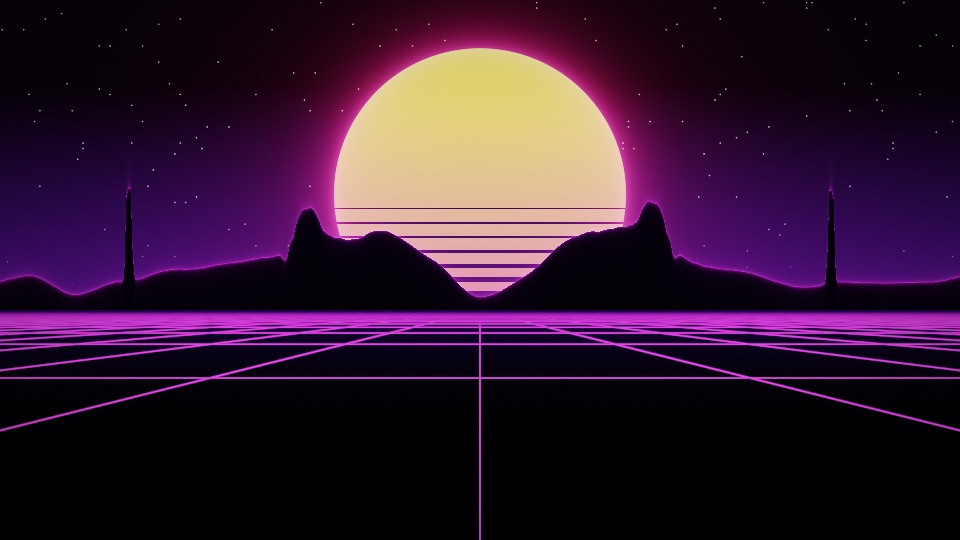
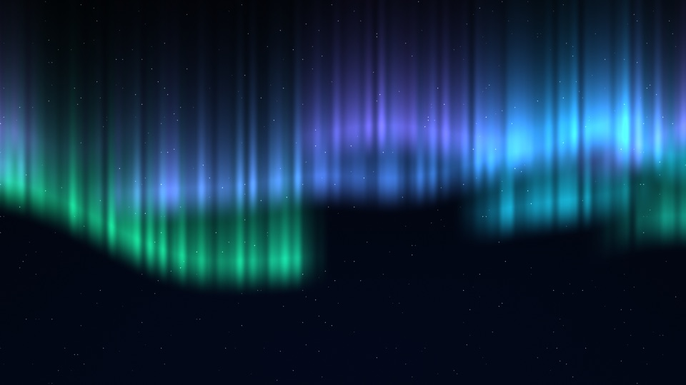

# iLiveWally

A live wallpaper engine for macOS, drawn with Metal. It lives in the menu bar and puts a moving wallpaper on every display, in the screen saver and on the lock screen, and can export the same look as a Live Photo for your iPhone and Apple Watch.


| | |
|---|---|
|  |  |

## Wallpapers

| Group | Wallpapers |
|---|---|
| Music reactive | Equalizer, Pulse Ring, Synthwave. They move to whatever the Mac is playing. |
| Ambient | Aurora, Liquid Gradient, Hyperspace, Digital Rain, Cosmic Flow |
| Console classics | PS3-style wave, PS4-style flow, PS5-style particles. Original shaders in that style. |

Every wallpaper has its own sliders and colors, plus shared Speed, Brightness, Contrast, Saturation, Hue, Vignette and Grain, with a live preview.

## Features

- **A wallpaper per place.** Each display, the screen saver and the lock screen can show a different one.
- **Screen saver.** The same renderer as a `.saver`, installed from the app.
- **Lock screen.** macOS paints the lock screen from its own wallpaper and lets no app window sit behind the clock. So the app keeps the macOS wallpaper set to a still of the live one, and starts the screen saver when the Mac locks. macOS draws the clock over the screen saver.
- **Matching menu bar.** The still also makes macOS tint the menu bar to match.
- **Live Photos.** One button makes a Live Photo sized for iPhone or Apple Watch and can add it to Photos.
- **Light on the Mac.** Drawing stops when windows cover the desktop. Frame rate and render scale are adjustable.

## Build

Needs macOS 14.4 or later and Xcode (the icon is compiled with `actool`). There is no Xcode project.

```bash
./build.sh
```

This runs a self-check, then writes `build/iLiveWally.app` with the screen saver inside it. Copy the app to Applications and open it.

The build is ad-hoc signed, so macOS asks again for audio permission after each rebuild. Set `SIGN_ID` to a signing identity to avoid that.

## Use

1. Open the app. It appears in the menu bar and its settings window opens.
2. Pick a place in the tab bar above the preview, then pick a wallpaper in the sidebar.
3. For the screen saver and moving lock screen, open "Engine, Saver & Lock", press "Install & Choose…" and pick iLiveWally in System Settings.
4. For your phone, press "Live Photo for iPhone", then "Add to Photos". On the iPhone, choose it as Lock Screen wallpaper and turn the Live button on.

## Limits

- Music-reactive wallpapers hear system audio only in the app. In the screen saver and in Live Photos they play to a built-in beat.
- On the lock screen the wallpaper moves while the screen saver is showing. Once you press a key, the password field appears over a still.
- Apple does not document what makes a Live Photo eligible as a moving wallpaper. The export follows a profile that others verified on an iPhone (60 fps HEVC and the camera's metadata tracks, see [live-photo-batch](https://github.com/pudding0503/live-photo-batch)), but iOS has the final say.

## Layout

| Path | What it is |
|---|---|
| `Sources/Shared` | Shaders, the wallpaper catalog, the Metal view and audio analysis. Used by the app and the screen saver. |
| `Sources/App` | Menu bar app, settings, system wallpaper matching, Live Photo export |
| `Sources/Saver` | The screen saver |
| `Tests/main.swift` | The self-check `build.sh` runs |
| `AppIcon.icon` | Icon Composer document |
